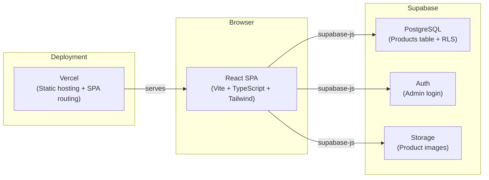
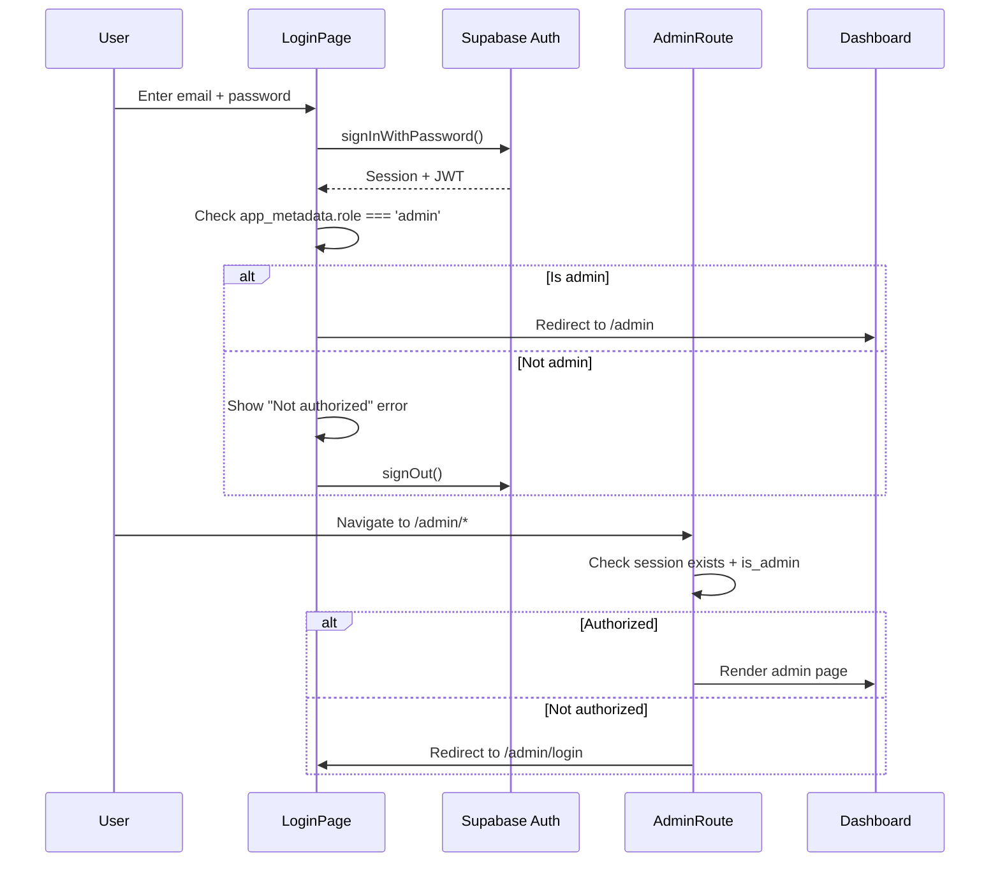
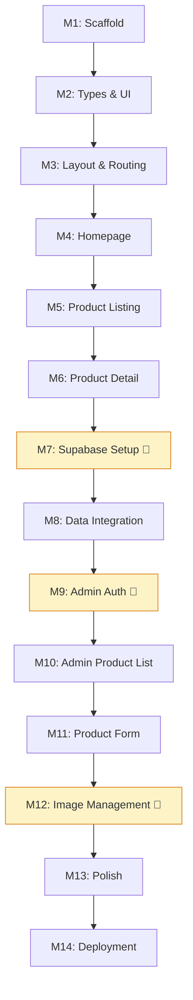

# AURELLE Jewellery Catalogue — Implementation Plan

## Goal

Build a production-ready, premium-looking catalogue website for an artificial jewellery business called **AURELLE**. The site includes a public-facing product catalogue and a minimal admin dashboard for the business owner to manage products. No cart, checkout, or payment processing.


---

## A. Repository Assessment

| Item | Finding |
|------|---------|
| **Existing code** | None — empty directory at `D:\catalouge` |
| **Git** | Not initialised |
| **Dependencies** | No `package.json` |
| **Config files** | None (`AGENTS.md`, `.env`, etc.) |
| **Reference material** | `ui-reference/Aurelle Jewelry Store & Admin Dashboard.png` — a high-quality composite mockup showing the public homepage (left) and admin dashboard with edit form (right) |
| **Tooling** | Node 22.13.1, npm 11.1.0, git 2.47.1 — all modern and suitable |

**Conclusion:** Greenfield project. Build from scratch preserving only the `ui-reference/` directory.

---

## B. Architecture

### High-Level Architecture



> [!IMPORTANT]
> **No separate backend.** The React SPA communicates directly with Supabase using the `@supabase/supabase-js` client. All authorization is enforced server-side via Row Level Security and Storage policies. The Supabase anon key (safe for browsers) is the only key used in frontend code.

### Routes

| Route | Page | Auth Required | Description |
|-------|------|:---:|-------------|
| `/` | `HomePage` | No | Hero, categories, featured products |
| `/products` | `ProductsPage` | No | Full catalogue with search + filters |
| `/products/:productCode` | `ProductDetailPage` | No | Single product with images, colours, WhatsApp CTA |
| `/admin/login` | `LoginPage` | No | Admin email/password login |
| `/admin` | `AdminProductsPage` | **Yes** | Product table with search, filters, delete |
| `/admin/products/new` | `AdminProductFormPage` | **Yes** | Add new product form |
| `/admin/products/:id/edit` | `AdminProductFormPage` | **Yes** | Edit existing product form |

> [!NOTE]
> Category filtering uses query parameters (`/products?category=Necklaces`) rather than separate `/category/:slug` routes. This avoids duplicating the product listing component and simplifies routing.

### Key Libraries (Minimal)

| Package | Purpose |
|---------|---------|
| `react`, `react-dom` | UI framework |
| `react-router-dom` | Client-side routing |
| `@supabase/supabase-js` | Database, auth, storage client |
| `tailwindcss`, `postcss`, `autoprefixer` | Styling |
| `@tailwindcss/forms` | Form element reset for Tailwind |

No state management library (React context + local state is sufficient). No additional UI library. No separate backend framework.

---

## C. Database & Permissions

### Product Schema

```sql
-- Migration 001: Create products table
CREATE TABLE products (
  id            UUID PRIMARY KEY DEFAULT gen_random_uuid(),
  product_code  TEXT NOT NULL,
  name          TEXT NOT NULL,
  category      TEXT NOT NULL,
  description   TEXT NOT NULL DEFAULT '',
  colors        TEXT[] NOT NULL DEFAULT '{}',
  images        TEXT[] NOT NULL DEFAULT '{}',
  is_active     BOOLEAN NOT NULL DEFAULT true,
  is_featured   BOOLEAN NOT NULL DEFAULT false,
  created_at    TIMESTAMPTZ NOT NULL DEFAULT now(),
  updated_at    TIMESTAMPTZ NOT NULL DEFAULT now()
);

-- Enforce unique product codes
ALTER TABLE products ADD CONSTRAINT uq_products_product_code UNIQUE (product_code);

-- Check category is valid
ALTER TABLE products ADD CONSTRAINT chk_products_category
  CHECK (category IN ('Necklaces', 'Earrings', 'Bracelets', 'Rings', 'Bangles'));

-- Indexes for common queries
CREATE INDEX idx_products_category ON products (category);
CREATE INDEX idx_products_is_active ON products (is_active) WHERE is_active = true;
CREATE INDEX idx_products_is_featured ON products (is_featured) WHERE is_featured = true;
CREATE INDEX idx_products_product_code ON products (product_code);

-- Auto-update updated_at
CREATE OR REPLACE FUNCTION update_updated_at()
RETURNS TRIGGER AS $$
BEGIN
  NEW.updated_at = now();
  RETURN NEW;
END;
$$ LANGUAGE plpgsql;

CREATE TRIGGER trg_products_updated_at
  BEFORE UPDATE ON products
  FOR EACH ROW EXECUTE FUNCTION update_updated_at();
```

> [!NOTE]
> **Category design decision:** Categories are stored as constrained `TEXT` values rather than a separate `categories` table. This is the simplest approach for 5 fixed categories. To add a category later, run `ALTER TABLE products DROP CONSTRAINT chk_products_category; ALTER TABLE products ADD CONSTRAINT chk_products_category CHECK (category IN ('Necklaces', 'Earrings', 'Bracelets', 'Rings', 'Bangles', 'NewCategory'));`. When dynamic category management is needed, migrate to a `categories` table with a foreign key.

> [!NOTE]
> **Colors design decision:** Stored as `TEXT[]` containing colour names (e.g., `{'Gold', 'Silver', 'Rose Gold'}`). A config file in the frontend maps names → hex values for display. Adding a new colour means adding one entry to the config. This avoids a join table while keeping colours extensible.

### Admin Identification

Administrators are identified via Supabase Auth **`app_metadata`**:

```json
{ "role": "admin" }
```

`app_metadata` is:
- Included in the JWT automatically by Supabase
- **Only writable server-side** (via dashboard SQL editor or service-role API) — users cannot self-assign admin
- Readable in RLS policies via `auth.jwt() -> 'app_metadata' ->> 'role'`

**Helper function for RLS:**

```sql
-- Migration 002: Admin helper + RLS policies
CREATE OR REPLACE FUNCTION public.is_admin()
RETURNS BOOLEAN
LANGUAGE sql
STABLE
SECURITY DEFINER
AS $$
  SELECT coalesce(
    (auth.jwt() -> 'app_metadata' ->> 'role') = 'admin',
    false
  )
$$;
```

### Row Level Security Policies

```sql
-- Enable RLS
ALTER TABLE products ENABLE ROW LEVEL SECURITY;

-- 1. Public: read active products only
CREATE POLICY "Public can view active products"
  ON products FOR SELECT
  TO anon, authenticated
  USING (is_active = true);

-- 2. Admin: read ALL products (including inactive)
CREATE POLICY "Admin can view all products"
  ON products FOR SELECT
  TO authenticated
  USING (public.is_admin());

-- 3. Admin: insert products
CREATE POLICY "Admin can insert products"
  ON products FOR INSERT
  TO authenticated
  WITH CHECK (public.is_admin());

-- 4. Admin: update products
CREATE POLICY "Admin can update products"
  ON products FOR UPDATE
  TO authenticated
  USING (public.is_admin())
  WITH CHECK (public.is_admin());

-- 5. Admin: delete products
CREATE POLICY "Admin can delete products"
  ON products FOR DELETE
  TO authenticated
  USING (public.is_admin());
```

> [!IMPORTANT]
> RLS SELECT policies are **OR-combined** by PostgreSQL. A public visitor sees rows where `is_active = true`. An admin sees those **plus** rows matched by the admin policy (all rows). This is correct behaviour — no conflicts.

### Storage Policies

```sql
-- Migration 003: Storage bucket and policies

-- Create bucket (via Supabase dashboard or SQL)
INSERT INTO storage.buckets (id, name, public)
VALUES ('product-images', 'product-images', true);

-- Public read (images are displayed on the public website)
CREATE POLICY "Public can read product images"
  ON storage.objects FOR SELECT
  TO anon, authenticated
  USING (bucket_id = 'product-images');

-- Admin upload
CREATE POLICY "Admin can upload product images"
  ON storage.objects FOR INSERT
  TO authenticated
  WITH CHECK (
    bucket_id = 'product-images'
    AND public.is_admin()
  );

-- Admin update (replace)
CREATE POLICY "Admin can update product images"
  ON storage.objects FOR UPDATE
  TO authenticated
  USING (
    bucket_id = 'product-images'
    AND public.is_admin()
  );

-- Admin delete
CREATE POLICY "Admin can delete product images"
  ON storage.objects FOR DELETE
  TO authenticated
  USING (
    bucket_id = 'product-images'
    AND public.is_admin()
  );
```

### Initial Admin Setup

> [!CAUTION]
> There is no public registration. The first admin account must be created manually:
>
> 1. In the **Supabase Dashboard → Authentication → Users**, click **Add user** and create a user with email + password.
> 2. In the **SQL Editor**, run:
>    ```sql
>    UPDATE auth.users
>    SET raw_app_meta_data = raw_app_meta_data || '{"role": "admin"}'::jsonb
>    WHERE email = 'admin@yourdomain.com';
>    ```
> 3. The user must **log out and log back in** to receive a JWT with the updated `app_metadata`.
>
> Never expose a public endpoint that grants admin role.

---

## D. Directory Structure

```
D:\catalouge/
├── ui-reference/
│   └── Aurelle Jewelry Store & Admin Dashboard.png
├── docs/
│   ├── implementation-plan.md          # Stable copy of this plan
│   └── migrations/
│       ├── 001_create_products.sql
│       ├── 002_rls_policies.sql
│       └── 003_storage_policies.sql
├── public/
│   └── favicon.svg
├── src/
│   ├── main.tsx                        # React entry point
│   ├── App.tsx                         # Router setup
│   ├── index.css                       # Tailwind directives + custom styles
│   ├── vite-env.d.ts
│   │
│   ├── config/
│   │   ├── constants.ts                # Brand, categories, colours, WhatsApp
│   │   └── supabase.ts                 # Supabase client initialisation
│   │
│   ├── types/
│   │   └── product.ts                  # Product, Category, ColorOption types
│   │
│   ├── lib/
│   │   ├── products.ts                 # Product CRUD data-access functions
│   │   ├── storage.ts                  # Image upload/delete helpers
│   │   └── auth.ts                     # Auth helper functions
│   │
│   ├── hooks/
│   │   ├── useProducts.ts              # Fetch products with filters
│   │   ├── useProduct.ts               # Fetch single product
│   │   ├── useAuth.ts                  # Auth state + login/logout
│   │   └── useImageUpload.ts           # Upload state management
│   │
│   ├── components/
│   │   ├── ui/                         # Generic reusable primitives
│   │   │   ├── Button.tsx
│   │   │   ├── Input.tsx
│   │   │   ├── Select.tsx
│   │   │   ├── Badge.tsx
│   │   │   ├── Modal.tsx
│   │   │   ├── Spinner.tsx
│   │   │   ├── Toast.tsx
│   │   │   └── EmptyState.tsx
│   │   │
│   │   ├── layout/
│   │   │   ├── PublicLayout.tsx         # Header + Footer wrapper
│   │   │   ├── Header.tsx              # Nav, search, WhatsApp, Contact
│   │   │   ├── MobileMenu.tsx          # Responsive mobile nav
│   │   │   ├── Footer.tsx              # Business info + links
│   │   │   ├── AdminLayout.tsx         # Sidebar + top bar wrapper
│   │   │   └── AdminSidebar.tsx        # Products (active), Categories/Media (disabled)
│   │   │
│   │   ├── product/                    # Public product display components
│   │   │   ├── ProductCard.tsx         # Image, code, name, colours, CTA
│   │   │   ├── ProductGrid.tsx         # Responsive grid wrapper
│   │   │   ├── ProductFilters.tsx      # Category dropdown + search input
│   │   │   ├── ProductImageGallery.tsx # Multi-image viewer on detail page
│   │   │   └── ColorDots.tsx           # Colour swatch circles
│   │   │
│   │   └── admin/                      # Admin-specific components
│   │       ├── ProductTable.tsx         # Data table with actions
│   │       ├── ProductForm.tsx          # Add/edit form fields
│   │       ├── ImageUploader.tsx        # Drag-drop upload + previews
│   │       ├── ColorSelector.tsx        # Toggle available colours
│   │       └── DeleteConfirmModal.tsx   # Deletion confirmation dialog
│   │
│   ├── pages/
│   │   ├── public/
│   │   │   ├── HomePage.tsx
│   │   │   ├── ProductsPage.tsx
│   │   │   ├── ProductDetailPage.tsx
│   │   │   └── NotFoundPage.tsx
│   │   │
│   │   └── admin/
│   │       ├── LoginPage.tsx
│   │       ├── AdminProductsPage.tsx
│   │       └── AdminProductFormPage.tsx
│   │
│   └── router/
│       ├── index.tsx                    # Route definitions
│       └── AdminRoute.tsx              # Auth guard HOC
│
├── .env.example                         # Template for env vars
├── .gitignore
├── index.html
├── package.json
├── postcss.config.js
├── tailwind.config.ts
├── tsconfig.json
├── tsconfig.app.json
├── tsconfig.node.json
├── vite.config.ts
└── AGENTS.md                           # Project instructions for AI agents
```

---

## E. Design System

### Visual Direction (derived from reference mockup)

The mockup establishes a **warm, editorial jewellery brand** aesthetic — not a generic e-commerce template.

### Colour Palette

| Token | Hex | Usage |
|-------|-----|-------|
| `cream` | `#FFFBF5` | Page background |
| `ivory` | `#F5F0E8` | Card backgrounds, secondary sections |
| `brand-dark` | `#2C2418` | Primary text, headlines |
| `brand-brown` | `#5C4A32` | Buttons, nav links, accents |
| `brand-gold` | `#C9A96E` | Decorative gold accents |
| `warm-gray` | `#8A7D6B` | Secondary text, placeholders |
| `border` | `#E8E0D4` | Borders, dividers |
| `white` | `#FFFFFF` | Cards, admin background |
| `success` | `#22C55E` | Active status badge |
| `danger` | `#EF4444` | Delete actions, error states |

### Typography

| Element | Font | Weight | Usage |
|---------|------|--------|-------|
| Headlines | **Playfair Display** (serif) | 400, 600 | Hero headline, section titles |
| Body text | **Inter** (sans-serif) | 400, 500, 600 | Navigation, product info, forms, admin |

Load via Google Fonts in `index.html`:
```html
<link href="https://fonts.googleapis.com/css2?family=Inter:wght@400;500;600&family=Playfair+Display:wght@400;600&display=swap" rel="stylesheet">
```

### Tailwind Config Tokens

```typescript
// tailwind.config.ts
import type { Config } from 'tailwindcss';

export default {
  content: ['./index.html', './src/**/*.{ts,tsx}'],
  theme: {
    extend: {
      colors: {
        cream:       '#FFFBF5',
        ivory:       '#F5F0E8',
        'brand-dark':'#2C2418',
        'brand-brown':'#5C4A32',
        'brand-gold':'#C9A96E',
        'warm-gray': '#8A7D6B',
        border:      '#E8E0D4',
      },
      fontFamily: {
        serif:  ['Playfair Display', 'Georgia', 'serif'],
        sans:   ['Inter', 'system-ui', 'sans-serif'],
      },
    },
  },
  plugins: [require('@tailwindcss/forms')],
} satisfies Config;
```

### Product Colour Swatches (Config)

```typescript
// src/config/constants.ts
export const BRAND_NAME = 'AURELLE';

export const WHATSAPP_NUMBER = import.meta.env.VITE_WHATSAPP_NUMBER || '';

export const CATEGORIES = [
  'Necklaces',
  'Earrings',
  'Bracelets',
  'Rings',
  'Bangles',
] as const;

export type Category = (typeof CATEGORIES)[number];

export const COLOR_OPTIONS: { name: string; hex: string }[] = [
  { name: 'Gold',      hex: '#D4A853' },
  { name: 'Silver',    hex: '#C0C0C0' },
  { name: 'Rose Gold', hex: '#E8B4A0' },
  { name: 'Antique',   hex: '#8B7355' },
  { name: 'Black',     hex: '#2C2C2C' },
  { name: 'White',     hex: '#F5F5F0' },
];
```

### Component Patterns

| Pattern | Details |
|---------|---------|
| **Product card** | 3:4 aspect ratio image, product code in `warm-gray`, name in `brand-dark`, colour dots below, WhatsApp CTA button |
| **Category card** | Square image, category name + arrow overlay at bottom |
| **Buttons** | Primary: `bg-brand-brown text-white`; Secondary: outlined with `border-brand-brown`; Rounded corners (`rounded-md`) |
| **Spacing** | Generous: `py-16` to `py-24` between sections; `gap-6` in grids |
| **Borders** | Subtle: `border-border` (1px), no heavy shadows |
| **Responsive grid** | 1 col mobile → 2 col tablet → 3-4 col desktop |
| **Admin** | White background, clean table with `divide-y`, standard form inputs, no decorative styling |

### WhatsApp Integration

```typescript
// Helper to generate WhatsApp link
export function getWhatsAppLink(productCode?: string, productName?: string): string {
  const base = `https://wa.me/${WHATSAPP_NUMBER}`;
  if (productCode && productName) {
    const message = encodeURIComponent(
      `Hi, I'm interested in ${productName} (${productCode}). Could you share more details?`
    );
    return `${base}?text=${message}`;
  }
  return base;
}
```

---

## F. Ordered Implementation Milestones

### Milestone 1 — Project Scaffold & Configuration

**Scope:** Initialise the Vite + React + TypeScript project, install dependencies, configure Tailwind with design tokens, set up folder structure, git init.

**Files created:**
- All config files: `package.json`, `vite.config.ts`, `tsconfig.json`, `tsconfig.app.json`, `tsconfig.node.json`, `postcss.config.js`, `tailwind.config.ts`
- `index.html` (with Google Fonts link)
- `src/main.tsx`, `src/App.tsx`, `src/index.css`, `src/vite-env.d.ts`
- `.env.example`, `.gitignore`
- Empty directory structure under `src/`
- `AGENTS.md`

**Dependencies:** None (first milestone)

**Model recommendation:** ⚡ Flash — mechanical scaffolding

**Acceptance criteria:**
1. `npm run dev` starts the dev server and shows a placeholder page
2. `npm run build` succeeds with zero errors
3. `npx tsc --noEmit` passes with zero type errors
4. Tailwind custom colours are visible in the placeholder page
5. Serif and sans-serif fonts load correctly
6. `.env.example` contains `VITE_SUPABASE_URL`, `VITE_SUPABASE_ANON_KEY`, `VITE_WHATSAPP_NUMBER`

**Verification commands:**
```bash
npm run dev          # → opens in browser, check fonts + colours
npm run build        # → zero errors
npx tsc --noEmit     # → zero type errors
```

---

### Milestone 2 — Types, Constants & Shared UI Components

**Scope:** Define TypeScript types, configuration constants, and reusable UI primitives that all subsequent milestones depend on.

**Files created:**
- `src/types/product.ts`
- `src/config/constants.ts`
- `src/components/ui/Button.tsx`
- `src/components/ui/Input.tsx`
- `src/components/ui/Select.tsx`
- `src/components/ui/Badge.tsx`
- `src/components/ui/Modal.tsx`
- `src/components/ui/Spinner.tsx`
- `src/components/ui/Toast.tsx`
- `src/components/ui/EmptyState.tsx`

**Key type definitions:**

```typescript
// src/types/product.ts
export interface Product {
  id: string;
  product_code: string;
  name: string;
  category: string;
  description: string;
  colors: string[];
  images: string[];
  is_active: boolean;
  is_featured: boolean;
  created_at: string;
  updated_at: string;
}

export interface ProductFormData {
  product_code: string;
  name: string;
  category: string;
  description: string;
  colors: string[];
  is_active: boolean;
  is_featured: boolean;
}
```

**Dependencies:** Milestone 1

**Model recommendation:** ⚡ Flash — pattern-based UI components

**Acceptance criteria:**
1. `npx tsc --noEmit` passes
2. Each UI component renders correctly in isolation (visually inspect via a temporary test page)
3. `Button` supports `variant` (primary, secondary, danger) and `loading` state
4. `Modal` opens/closes with overlay and body scroll lock
5. `Spinner`, `EmptyState`, `Toast` display correct visual states

---

### Milestone 3 — Public Layout Shell & Routing

**Scope:** Build the Header (nav, search, WhatsApp icon, Contact), Footer, PublicLayout, mobile menu, and wire up React Router with placeholder pages.

**Files created:**
- `src/components/layout/Header.tsx`
- `src/components/layout/MobileMenu.tsx`
- `src/components/layout/Footer.tsx`
- `src/components/layout/PublicLayout.tsx`
- `src/router/index.tsx`
- `src/pages/public/HomePage.tsx` (placeholder)
- `src/pages/public/ProductsPage.tsx` (placeholder)
- `src/pages/public/ProductDetailPage.tsx` (placeholder)
- `src/pages/public/NotFoundPage.tsx`

**Files modified:**
- `src/App.tsx` — integrate router

**Dependencies:** Milestones 1, 2

**Model recommendation:** ⚡ Flash — standard layout + routing patterns

**Acceptance criteria:**
1. Header renders with AURELLE brand, category navigation links, search field, WhatsApp icon, Contact button
2. Footer renders with placeholder business info and navigation links
3. Navigation between `/`, `/products`, `/products/test-code` works
4. Mobile hamburger menu opens/closes, showing full navigation
5. Active route is visually indicated in navigation
6. 404 page renders for unknown routes
7. `npm run build` succeeds

---

### Milestone 4 — Homepage

**Scope:** Build the full homepage matching the reference mockup. Use hardcoded mock data for featured products and category images.

**Files created:**
- `src/components/product/ProductCard.tsx`
- `src/components/product/ColorDots.tsx`

**Files modified:**
- `src/pages/public/HomePage.tsx` — full implementation

**Homepage sections (matching mockup):**
1. **Hero:** Full-width image background, "JEWELLERY FOR EVERY YOU" eyebrow, "Everyday pieces. Remarkable details." serif headline, description, "Explore the collection →" CTA, three value-prop icons
2. **Shop by category:** Section heading + "View all categories →" link, 4 category cards (image + name + arrow)
3. **Featured pieces:** Section heading + "View all products →" link, 4 product cards with mock data

**Dependencies:** Milestone 3

**Model recommendation:** ⚡ Flash — visual implementation following mockup closely

**Acceptance criteria:**
1. Visual fidelity to the left half of the reference mockup
2. Hero section fills viewport width with image, text overlay is readable
3. Category cards link to `/products?category=Necklaces` (etc.)
4. Product cards show: image, product code, name, colour dots, "Enquire on WhatsApp" button
5. WhatsApp button opens `https://wa.me/{number}?text=...` (or placeholder if no number)
6. Responsive: stacks to 1-2 columns on mobile, proper spacing

> [!NOTE]
> Use placeholder images from [Unsplash](https://unsplash.com) or solid-colour placeholders during development. These will be replaced by real images once Supabase Storage is integrated.

---

### Milestone 5 — Product Listing & Filtering

**Scope:** Build the product listing page with search, category filter, responsive grid, and empty state. Uses mock data array.

**Files created:**
- `src/components/product/ProductGrid.tsx`
- `src/components/product/ProductFilters.tsx`
- Mock data file: `src/lib/mock-data.ts`

**Files modified:**
- `src/pages/public/ProductsPage.tsx` — full implementation
- `src/pages/public/HomePage.tsx` — import mock data from shared file

**Key behaviour:**
- Search filters by product name OR product code (case-insensitive substring match)
- Category dropdown filters by exact category match
- Search and filter work **together** (combined AND logic, not independent)
- URL query params reflect filters: `/products?category=Rings&search=floral`
- Empty state shown when no products match
- Clearing filters restores full list

**Dependencies:** Milestone 4

**Model recommendation:** ⚡ Flash — standard filter/search logic

**Acceptance criteria:**
1. Product grid displays all mock products with correct cards
2. Search by name returns matching products
3. Search by product code returns matching products
4. Category filter narrows results
5. Combined search + filter returns intersection
6. Empty state displays when no results match
7. Clearing search/filter restores all products
8. URL updates with query params; refreshing preserves filter state
9. Responsive grid: 1 col → 2 col → 3-4 col

---

### Milestone 6 — Product Detail Page

**Scope:** Build the product detail page with image gallery, product info, colour display, and WhatsApp CTA.

**Files created:**
- `src/components/product/ProductImageGallery.tsx`

**Files modified:**
- `src/pages/public/ProductDetailPage.tsx` — full implementation

**Key behaviour:**
- Route: `/products/:productCode`
- Looks up product by `product_code` from mock data
- Image gallery: large main image + thumbnail strip; clicking thumbnail changes main image
- Displays: product code, name, category, description, colour dots with labels
- "Enquire on WhatsApp" button with pre-filled message including product code + name
- Shows 404/not-found state for invalid product codes
- Back navigation to product listing

**Dependencies:** Milestone 5

**Model recommendation:** ⚡ Flash — standard detail page pattern

**Acceptance criteria:**
1. Navigating from product card opens correct detail page
2. All product fields display correctly
3. Image gallery shows thumbnails; clicking switches main image
4. WhatsApp CTA generates correct link with product info
5. Invalid product code shows not-found state
6. Back button returns to listing (preserving filters if possible)
7. Responsive layout on mobile

---

### Milestone 7 — Supabase Project Setup & Database Migrations

**Scope:** Create the Supabase project, run SQL migrations for the products table, RLS policies, storage bucket, and storage policies. Create the initial admin user.

**Files created:**
- `docs/migrations/001_create_products.sql`
- `docs/migrations/002_rls_policies.sql`
- `docs/migrations/003_storage_policies.sql`
- `docs/supabase-setup.md`

**Files modified:**
- `.env.example` — document all required variables
- `.env.local` — populated with real Supabase credentials (gitignored)

> [!CAUTION]
> **This milestone involves security-critical SQL.** Use a stronger model (Opus/Sonnet) to write and review the migration files. Have the user execute them manually in the Supabase SQL Editor after review.

**Dependencies:** Milestones 1-6 (public UI complete with mock data)

**Model recommendation:** 🧠 **Opus/Sonnet** — security-critical SQL and RLS policies

**Acceptance criteria:**
1. Products table exists with all columns, constraints, and indexes
2. `product_code` UNIQUE constraint rejects duplicates:
   ```sql
   INSERT INTO products (product_code, name, category) VALUES ('AU-NK-001', 'Test', 'Necklaces');
   INSERT INTO products (product_code, name, category) VALUES ('AU-NK-001', 'Dupe', 'Necklaces');
   -- Second insert must fail with unique violation
   ```
3. Category CHECK constraint rejects invalid categories
4. `updated_at` trigger fires on UPDATE
5. RLS is enabled; anonymous query returns only `is_active = true` rows
6. Authenticated non-admin cannot INSERT/UPDATE/DELETE
7. Admin can perform all CRUD operations
8. Storage bucket `product-images` exists and is public for reads
9. Non-admin cannot upload to storage
10. Admin can upload, replace, and delete images

**Verification (manual in Supabase SQL Editor):**
```sql
-- Test RLS as anon
SET request.jwt.claims = '{"role": "anon"}';
SELECT * FROM products; -- should return only active

-- Test RLS as non-admin authenticated
SET request.jwt.claims = '{"role": "authenticated", "app_metadata": {}}';
INSERT INTO products (product_code, name, category) VALUES ('test', 'test', 'Rings');
-- should fail

-- Test RLS as admin
SET request.jwt.claims = '{"role": "authenticated", "app_metadata": {"role": "admin"}}';
INSERT INTO products (product_code, name, category) VALUES ('test', 'test', 'Rings');
-- should succeed
DELETE FROM products WHERE product_code = 'test';
```

---

### Milestone 8 — Supabase Client & Data Integration

**Scope:** Configure the Supabase JS client, create typed data-access functions, replace mock data with live Supabase queries in all public pages.

**Files created:**
- `src/config/supabase.ts`
- `src/lib/products.ts`
- `src/hooks/useProducts.ts`
- `src/hooks/useProduct.ts`

**Files modified:**
- `src/pages/public/HomePage.tsx` — fetch featured products from Supabase
- `src/pages/public/ProductsPage.tsx` — fetch + filter from Supabase
- `src/pages/public/ProductDetailPage.tsx` — fetch single product from Supabase

**Supabase client setup:**
```typescript
// src/config/supabase.ts
import { createClient } from '@supabase/supabase-js';

const supabaseUrl = import.meta.env.VITE_SUPABASE_URL;
const supabaseAnonKey = import.meta.env.VITE_SUPABASE_ANON_KEY;

if (!supabaseUrl || !supabaseAnonKey) {
  throw new Error('Missing Supabase environment variables');
}

export const supabase = createClient(supabaseUrl, supabaseAnonKey);
```

**Data access pattern:**
```typescript
// src/lib/products.ts
export async function fetchActiveProducts(filters?: {
  category?: string;
  search?: string;
}): Promise<Product[]> {
  let query = supabase
    .from('products')
    .select('*')
    .eq('is_active', true)
    .order('created_at', { ascending: false });

  if (filters?.category) {
    query = query.eq('category', filters.category);
  }
  if (filters?.search) {
    query = query.or(
      `name.ilike.%${filters.search}%,product_code.ilike.%${filters.search}%`
    );
  }

  const { data, error } = await query;
  if (error) throw error;
  return data ?? [];
}
```

**Dependencies:** Milestone 7

**Model recommendation:** ⚡ Flash (with Opus/Sonnet review of query patterns)

**Acceptance criteria:**
1. Public pages load products from Supabase (seed 4+ test products first)
2. Search and filter work against live data
3. Only `is_active = true` products appear on public pages
4. Product detail page loads correct product by `product_code`
5. Loading spinners display during fetch
6. Error state displays on network failure
7. `npm run build` succeeds — no type errors
8. Mock data file can be deleted (or retained for reference)

---

### Milestone 9 — Admin Authentication

**Scope:** Build admin login page, auth context, protected route wrapper, and logout.

**Files created:**
- `src/lib/auth.ts`
- `src/hooks/useAuth.ts`
- `src/router/AdminRoute.tsx`
- `src/pages/admin/LoginPage.tsx`

**Files modified:**
- `src/router/index.tsx` — add admin routes with `AdminRoute` guard
- `src/App.tsx` — wrap with auth provider if using context

**Auth flow:**



> [!IMPORTANT]
> **Double authorization check:** The frontend checks `app_metadata.role === 'admin'` before allowing navigation to admin pages. But this is only a UX convenience — the real enforcement is via RLS policies on the database and storage. Even if someone bypasses the frontend guard, they cannot modify data.

**Dependencies:** Milestone 8

**Model recommendation:** 🧠 **Opus/Sonnet** — authentication logic is security-critical

**Acceptance criteria:**
1. `/admin/login` shows email + password form
2. Valid admin credentials → redirect to `/admin`
3. Valid non-admin credentials → "Not authorized" error + sign out
4. Invalid credentials → appropriate error message
5. Navigating to `/admin/*` without session → redirect to `/admin/login`
6. Logout clears session and redirects to `/admin/login`
7. Session persists across page reloads (Supabase handles this)
8. No registration form or link exists anywhere

---

### Milestone 10 — Admin Product List & Delete

**Scope:** Build the admin layout, sidebar, product catalogue page with table, search, filters, stats, and delete functionality.

**Files created:**
- `src/components/layout/AdminLayout.tsx`
- `src/components/layout/AdminSidebar.tsx`
- `src/components/admin/ProductTable.tsx`
- `src/components/admin/DeleteConfirmModal.tsx`
- `src/pages/admin/AdminProductsPage.tsx`

**Files modified:**
- `src/lib/products.ts` — add `fetchAllProducts()`, `deleteProduct()` functions
- `src/router/index.tsx` — add admin routes

**Admin layout matches mockup:**
- Left sidebar: AURELLE logo, Products (active), Categories (disabled), Media (disabled)
- Top bar: Admin avatar/name + dropdown with logout
- Main area: "Product catalogue" heading + "Manage products" subtitle
- Stats: product count, category count
- "+ Add product" button
- Search + category filter + status filter
- Product table: Image | Product ID | Name | Category | Colors | Status | Edit | Delete

**Dependencies:** Milestone 9

**Model recommendation:** ⚡ Flash — standard admin table pattern

**Acceptance criteria:**
1. Admin layout renders with sidebar navigation
2. Product table displays all products (including inactive)
3. Search filters table by name or product code
4. Category dropdown filters by category
5. Status dropdown filters by active/inactive
6. Stats show correct product and category counts
7. Delete button opens confirmation modal
8. Confirming delete removes product and shows success toast
9. Empty state shown when no products exist
10. "+ Add product" navigates to `/admin/products/new`
11. "Edit" navigates to `/admin/products/:id/edit`

---

### Milestone 11 — Admin Product Form (Add/Edit)

**Scope:** Build the product add/edit form with all fields, validation, and save logic. Image upload is deferred to Milestone 12 — this milestone handles text fields, category, colours, and active/featured toggles.

**Files created:**
- `src/components/admin/ProductForm.tsx`
- `src/components/admin/ColorSelector.tsx`
- `src/pages/admin/AdminProductFormPage.tsx`

**Files modified:**
- `src/lib/products.ts` — add `createProduct()`, `updateProduct()`, `checkProductCodeExists()` functions
- `src/router/index.tsx` — add form routes

**Form fields (matching mockup):**
- Product ID (text input) — validated for uniqueness
- Product name (text input) — required
- Category (dropdown) — from `CATEGORIES` constant
- Description (textarea)
- Available colours (toggleable colour swatches from `COLOR_OPTIONS`)
- Active toggle
- Featured toggle
- Image section — placeholder for Milestone 12
- Cancel + "Save changes" buttons

**Validation rules:**
| Field | Rule | Error message |
|-------|------|---------------|
| `product_code` | Required, unique | "Product ID is required" / "This Product ID already exists" |
| `name` | Required | "Product name is required" |
| `category` | Required, must be valid | "Please select a category" |
| `colors` | At least one selected | "Select at least one colour" |

**Uniqueness check:**
```typescript
export async function checkProductCodeExists(
  code: string,
  excludeId?: string
): Promise<boolean> {
  let query = supabase
    .from('products')
    .select('id')
    .eq('product_code', code);

  if (excludeId) {
    query = query.neq('id', excludeId);
  }

  const { data } = await query;
  return (data?.length ?? 0) > 0;
}
```

**Dependencies:** Milestone 10

**Model recommendation:** ⚡ Flash — standard form patterns (with Sonnet review for validation logic)

**Acceptance criteria:**
1. **Add mode** (`/admin/products/new`): empty form, all fields editable
2. **Edit mode** (`/admin/products/:id/edit`): form pre-populated with existing product data
3. Validation errors display inline beneath fields
4. Duplicate product code shows "already exists" error (checked before submit)
5. Duplicate product code is also rejected by database constraint (graceful error handling)
6. Successful create redirects to admin product list with success toast
7. Successful update redirects to admin product list with success toast
8. Cancel returns to product list without saving
9. Loading state on save button during submission
10. Network errors show appropriate error message

---

### Milestone 12 — Image Management

**Scope:** Implement image upload, preview, replacement, deletion, and cleanup using Supabase Storage.

**Files created:**
- `src/lib/storage.ts`
- `src/hooks/useImageUpload.ts`
- `src/components/admin/ImageUploader.tsx`

**Files modified:**
- `src/components/admin/ProductForm.tsx` — integrate ImageUploader
- `src/lib/products.ts` — update `deleteProduct()` to clean up images

**Storage structure:**
```
product-images/
  {product_uuid}/
    {timestamp}_{sanitized_filename}.{ext}
```

**Image operations:**

| Operation | Steps |
|-----------|-------|
| **Upload** | Validate type (JPG/PNG/WEBP) + size (≤5MB) → upload to `product-images/{productId}/{timestamp}_{name}` → append path to `images[]` → save product |
| **Remove single** | Remove path from `images[]` → delete file from storage → save product |
| **Replace** | Upload new file → swap path in `images[]` → delete old file from storage → save product |
| **Delete product** | List all objects in `product-images/{productId}/` → delete all → delete product record |
| **Reorder** | Reorder paths in `images[]` array → save product (first image = primary) |

**Image URL helper:**
```typescript
export function getImageUrl(path: string): string {
  return `${import.meta.env.VITE_SUPABASE_URL}/storage/v1/object/public/product-images/${path}`;
}
```

**ImageUploader component behaviour (matching mockup):**
- Dashed-border drop zone: "Click to upload images or drag and drop (JPG, PNG, WEBP)"
- Below: thumbnail strip with existing images
- Each thumbnail has an × remove button
- "+" button to add more images
- Upload progress bar during upload
- Error message for invalid file type or size

> [!WARNING]
> **Orphan cleanup edge case:** If the user uploads images but cancels the form (never saves), the uploaded files remain in storage. Mitigation options:
> 1. **Recommended (simple):** Only upload images on form save, not on file selection. Hold files in browser memory until save.
> 2. **Alternative:** Upload immediately but track "pending" uploads; clean up on cancel.
>
> Option 1 is simpler and avoids orphans entirely. The tradeoff is that all images upload at once on save, which may feel slower for many large images.

**Dependencies:** Milestone 11

**Model recommendation:** 🧠 **Opus/Sonnet** — complex async logic with storage operations

**Acceptance criteria:**
1. Drag-and-drop file selection works
2. Click-to-browse file selection works
3. Invalid file types are rejected with error message
4. Files over 5MB are rejected with error message
5. Upload progress is visible during save
6. Uploaded images appear as thumbnails in the form
7. Removing an image deletes it from storage (on save)
8. Image order can be changed (drag or move buttons)
9. Deleting a product removes all its images from storage
10. Public product pages display images from Supabase Storage
11. Missing images show a graceful fallback placeholder
12. `npm run build` succeeds

---

### Milestone 13 — Polish, Responsive Refinement & Error Handling

**Scope:** Final pass over all pages for responsive behaviour, loading/error/empty states, accessibility, and visual consistency.

**Checklist:**
- [ ] Mobile nav: hamburger menu works, links close menu, search is accessible
- [ ] Mobile product grid: single column, proper image sizing
- [ ] Mobile product detail: image gallery works on touch
- [ ] Mobile admin: table scrolls horizontally or switches to card layout
- [ ] Mobile admin form: fields stack vertically, image uploader works
- [ ] All loading states show spinner component
- [ ] All error states show retry action
- [ ] All empty states show helpful message + action
- [ ] Page `<title>` updates per route
- [ ] All images have `alt` text
- [ ] Interactive elements are keyboard-accessible
- [ ] Form inputs have associated labels
- [ ] Colour contrast meets WCAG AA
- [ ] Favicon is present

**Dependencies:** Milestone 12

**Model recommendation:** ⚡ Flash — incremental UI fixes

**Acceptance criteria:**
1. All pages render correctly at 375px, 768px, 1024px, 1440px widths
2. No horizontal scroll at any viewport
3. All interactive elements reachable via keyboard
4. Console shows no errors or warnings during normal usage
5. `npm run build` produces zero errors
6. Lighthouse accessibility score ≥ 90

---

### Milestone 14 — Deployment & Production Readiness

**Scope:** Deploy the frontend to Vercel, configure environment variables, verify production behaviour, document the process.

**Files created/modified:**
- `vercel.json` (SPA routing config)
- `docs/deployment.md`

**Vercel config:**
```json
{
  "rewrites": [{ "source": "/(.*)", "destination": "/index.html" }]
}
```

**Deployment steps:**
1. Push repository to GitHub
2. Connect GitHub repo to Vercel
3. Set environment variables in Vercel dashboard:
   - `VITE_SUPABASE_URL`
   - `VITE_SUPABASE_ANON_KEY`
   - `VITE_WHATSAPP_NUMBER`
4. Deploy
5. Verify: public pages load, images load from Supabase, admin login works, CRUD works
6. (Optional) Configure custom domain in Vercel + Supabase (redirect URLs)

**Dependencies:** Milestone 13

**Model recommendation:** ⚡ Flash — following deployment docs

**Acceptance criteria:**
1. Production URL loads the homepage
2. Product images load from Supabase Storage
3. Search and filtering work
4. Product detail pages work with direct URL access (SPA routing)
5. Admin login works
6. Admin CRUD operations work
7. Unauthorized API requests are rejected
8. No console errors in production
9. No secrets visible in client-side JavaScript bundles

---

## G. Testing Strategy

### Automated Checks (run after each milestone)

```bash
# Type check
npx tsc --noEmit

# Production build
npm run build

# Lint (if ESLint configured by Vite template)
npm run lint
```

### Manual Browser Tests

| Test | Page | Steps | Expected |
|------|------|-------|----------|
| Homepage renders | `/` | Load page | Hero, categories, featured products visible |
| Category navigation | `/` | Click "Necklaces" category card | Redirects to `/products?category=Necklaces` with filtered results |
| Search by name | `/products` | Type "floral" in search | Only products with "floral" in name shown |
| Search by code | `/products` | Type "AU-NK" in search | Only matching product codes shown |
| Combined filter | `/products` | Select "Rings" + search "bloom" | Intersection of both filters |
| Empty state | `/products` | Search "zzzzz" | "No products found" message |
| Product detail | `/products/AU-NK-012` | Navigate from listing | Correct product info, images, colours |
| Invalid product | `/products/INVALID` | Direct URL | Not found state |
| WhatsApp CTA | Product detail | Click "Enquire on WhatsApp" | Opens WhatsApp with pre-filled message |
| Admin login | `/admin/login` | Enter valid admin credentials | Redirects to `/admin` |
| Non-admin login | `/admin/login` | Enter valid non-admin credentials | "Not authorized" error |
| Admin guard | `/admin` | Clear session, navigate directly | Redirects to `/admin/login` |
| Add product | `/admin/products/new` | Fill form + save | Product appears in list |
| Duplicate code | `/admin/products/new` | Use existing product code | Validation error before save |
| Edit product | `/admin/products/:id/edit` | Change name + save | Updated name in list |
| Delete product | Admin list | Click delete + confirm | Product removed, images cleaned |
| Image upload | Product form | Drop JPG file | Preview appears |
| Image too large | Product form | Drop 10MB file | Size error message |
| Invalid image type | Product form | Drop .pdf file | Type error message |
| Image remove | Product form | Click × on thumbnail | Image removed from preview |
| Inactive product | Public pages | Set product inactive via admin | Product not visible on public pages |
| Mobile responsive | All pages | Resize to 375px width | Usable layout, no horizontal scroll |

### Backend Security Tests (Supabase SQL Editor)

```sql
-- 1. Anonymous cannot insert
-- (Use API explorer with anon key)
-- POST /rest/v1/products with product data → 403

-- 2. Authenticated non-admin cannot insert
-- (Create a regular user, get their JWT)
-- POST /rest/v1/products with their JWT → 403

-- 3. Admin can insert
-- POST /rest/v1/products with admin JWT → 201

-- 4. Anonymous sees only active products
-- GET /rest/v1/products with anon key → only is_active=true rows

-- 5. Product code uniqueness
-- INSERT duplicate product_code → unique_violation error
```

---

## H. Deployment

### Supabase Setup Checklist

1. **Create project** at [supabase.com](https://supabase.com)
2. **Run migrations** in SQL Editor:
   - `001_create_products.sql`
   - `002_rls_policies.sql`
   - `003_storage_policies.sql`
3. **Create admin user:**
   - Auth → Users → Add user (email + password)
   - SQL Editor: set `app_metadata` role
4. **Copy credentials:**
   - Project URL → `VITE_SUPABASE_URL`
   - Anon public key → `VITE_SUPABASE_ANON_KEY`
5. **Seed test data** (optional — insert a few products for testing)

### Vercel Deployment Checklist

1. Push code to GitHub
2. Import project in Vercel
3. Framework preset: Vite
4. Set environment variables:
   - `VITE_SUPABASE_URL`
   - `VITE_SUPABASE_ANON_KEY`
   - `VITE_WHATSAPP_NUMBER`
5. Deploy
6. Test production URL
7. (Optional) Add custom domain
8. (Optional) Update Supabase Auth redirect URLs for custom domain

### Environment Variables

| Variable | Where | Description |
|----------|-------|-------------|
| `VITE_SUPABASE_URL` | Vercel + `.env.local` | Supabase project URL |
| `VITE_SUPABASE_ANON_KEY` | Vercel + `.env.local` | Supabase anon/public key (safe for browser) |
| `VITE_WHATSAPP_NUMBER` | Vercel + `.env.local` | Business WhatsApp number (international format, no +) |

> [!CAUTION]
> **Never** add `SUPABASE_SERVICE_ROLE_KEY` to the frontend. It is only used in the Supabase dashboard or server-side scripts. The `VITE_` prefix makes variables available in browser bundles.

---

## I. Persistent Project Instructions

The following `AGENTS.md` should be created at the project root to guide future coding sessions:

```markdown
# AGENTS.md — AURELLE Jewellery Catalogue

## Project Overview
Production catalogue website for AURELLE artificial jewellery. Public product browsing + admin dashboard for product management.

## Stack
- Frontend: React 18 + TypeScript + Vite + Tailwind CSS
- Backend: Supabase (PostgreSQL + Auth + Storage) — no separate API server
- Deployment: Vercel (frontend) + Supabase (backend services)

## Architecture Rules
- All data access goes through `src/lib/` functions — no direct Supabase calls in components
- All authorization enforced server-side via Supabase RLS — frontend guards are UX only
- Only the anon key is used in browser code — never the service role key
- Product images stored in Supabase Storage bucket `product-images`
- Image paths stored in the `images` TEXT[] column, not as separate table rows

## Security Rules — DO NOT VIOLATE
1. Never disable Row Level Security on any table
2. Never use permissive RLS policies to work around bugs
3. Never expose the Supabase service role key in frontend code
4. Never assume authenticated === admin — always check app_metadata.role
5. Always validate file types and sizes before upload

## Data Model
- Single `products` table with UUID pk, unique `product_code`, TEXT[] for colors and images
- Categories: CHECK constraint, not a separate table (for now)
- Admin role: stored in Supabase Auth `app_metadata`

## Key Directories
- `src/config/` — Supabase client, brand constants, colour options
- `src/types/` — TypeScript type definitions
- `src/lib/` — Data access functions (products, storage, auth)
- `src/hooks/` — React hooks for data fetching and state
- `src/components/ui/` — Generic reusable UI primitives
- `src/components/layout/` — Header, Footer, AdminLayout
- `src/components/product/` — Public product display components
- `src/components/admin/` — Admin-specific components
- `src/pages/` — Page components (public/ and admin/)

## Categories (fixed for MVP)
Necklaces, Earrings, Bracelets, Rings, Bangles

## Design Tokens
- Background: cream #FFFBF5, ivory #F5F0E8
- Text: brand-dark #2C2418, warm-gray #8A7D6B
- Accent: brand-brown #5C4A32, brand-gold #C9A96E
- Fonts: Playfair Display (serif headlines), Inter (sans body)

## Verification After Changes
Always run: `npx tsc --noEmit && npm run build`
```

Additionally, copy the stable implementation plan to `docs/implementation-plan.md` for reference.

---

## J. Risks & Unresolved Decisions

### Confirmed Requirements

| Requirement | Status |
|-------------|--------|
| Brand name: AURELLE | ✅ Confirmed |
| Enquiry: WhatsApp (configurable number) | ✅ Confirmed |
| Categories: Necklaces, Earrings, Bracelets, Rings, Bangles | ✅ Confirmed |
| No cart/checkout/payment | ✅ Confirmed |
| Admin MVP: Products page only | ✅ Confirmed |
| No wishlist feature | ✅ Confirmed |
| Stack: React + Vite + Tailwind + Supabase | ✅ Confirmed |

### Assumptions (sensible defaults — override if needed)

| Assumption | Default | Impact if changed |
|------------|---------|-------------------|
| Product images: max 5MB per file | 5MB | Change validation in `ImageUploader` |
| Image formats: JPG, PNG, WEBP | All three | Update validation and upload area text |
| Max images per product | No hard limit (practical: ~10) | Add validation if needed |
| Product code format | Free text (AU-XX-NNN recommended) | Add regex validation if strict format needed |
| Available colours | Gold, Silver, Rose Gold, Antique, Black, White | Edit `COLOR_OPTIONS` in constants |
| Admin: single admin user initially | One user | `app_metadata` approach scales to multiple admins |
| Hero/category placeholder images | Unsplash or solid colours during dev | Replace with real photography before launch |

### Risks

| Risk | Severity | Mitigation |
|------|----------|------------|
| **Orphaned images** — uploaded but never saved to a product | Low | Upload images only on form save (hold in browser memory), not on file selection |
| **Large image uploads** — slow on mobile connections | Medium | Client-side compression before upload (deferred to later enhancement), progress indicator |
| **Supabase free tier limits** — 1GB storage, 500MB database | Low for catalogue | Monitor usage; upgrade if needed. Compress images before upload. |
| **SEO limitations** — SPA with client-side rendering | Medium | Add `<title>` and meta tags per route. Consider adding `react-helmet-async`. Full SSR is out of scope. |
| **WhatsApp number not yet provided** | None | Configurable via env var; CTA works but opens WhatsApp without a target number |
| **No real product photography yet** | None | Use placeholder images during development; replace before launch |
| **Browser back-button after admin delete** | Low | Ensure product list refetches on navigation; deleted product doesn't reappear |

### Decisions Explicitly Locked (do not revisit during implementation)

1. **No separate backend** — Supabase JS client directly from browser
2. **No state management library** — React context + local state
3. **Categories as CHECK constraint** — not a separate table
4. **Colors as TEXT[]** — not a join table
5. **Images as TEXT[]** — not a separate images table
6. **Admin via app_metadata** — not a separate admins table
7. **Upload on save** — not on file selection
8. **Single SPA** — public site and admin in one React app
9. **Vercel for hosting** — not Netlify, Cloudflare Pages, etc.

---

## Milestone Summary & Model Allocation

| # | Milestone | Model | Dependencies |
|---|-----------|-------|-------------|
| 1 | Project Scaffold & Configuration | ⚡ Flash | — |
| 2 | Types, Constants & Shared UI Components | ⚡ Flash | 1 |
| 3 | Public Layout Shell & Routing | ⚡ Flash | 1, 2 |
| 4 | Homepage | ⚡ Flash | 3 |
| 5 | Product Listing & Filtering | ⚡ Flash | 4 |
| 6 | Product Detail Page | ⚡ Flash | 5 |
| 7 | Supabase Setup & Database Migrations | 🧠 Opus/Sonnet | 1–6 |
| 8 | Supabase Client & Data Integration | ⚡ Flash + review | 7 |
| 9 | Admin Authentication | 🧠 Opus/Sonnet | 8 |
| 10 | Admin Product List & Delete | ⚡ Flash | 9 |
| 11 | Admin Product Form (Add/Edit) | ⚡ Flash + review | 10 |
| 12 | Image Management | 🧠 Opus/Sonnet | 11 |
| 13 | Polish & Responsive Refinement | ⚡ Flash | 12 |
| 14 | Deployment & Production | ⚡ Flash | 13 |



> [!TIP]
> **Model usage efficiency:** 11 of 14 milestones can be executed by Flash. Only milestones 7, 9, and 12 (database security, authentication, and image management) require Opus/Sonnet for authoring. A final Opus/Sonnet pass should review all security-sensitive code before production deployment.
